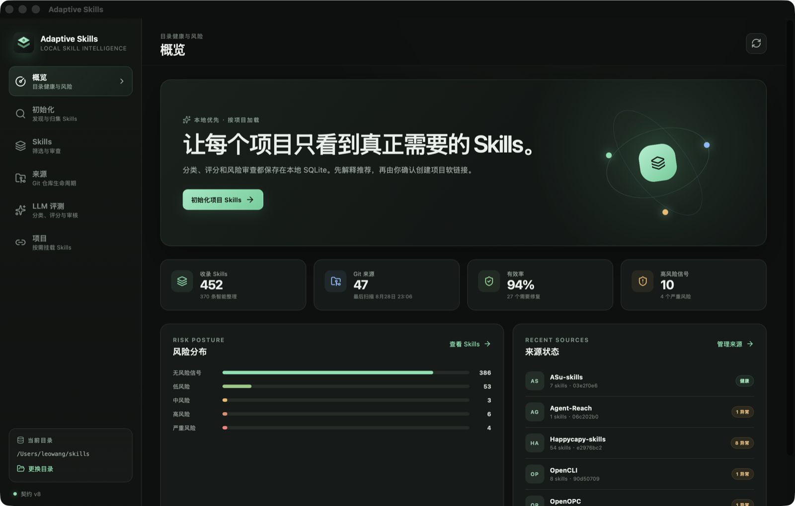
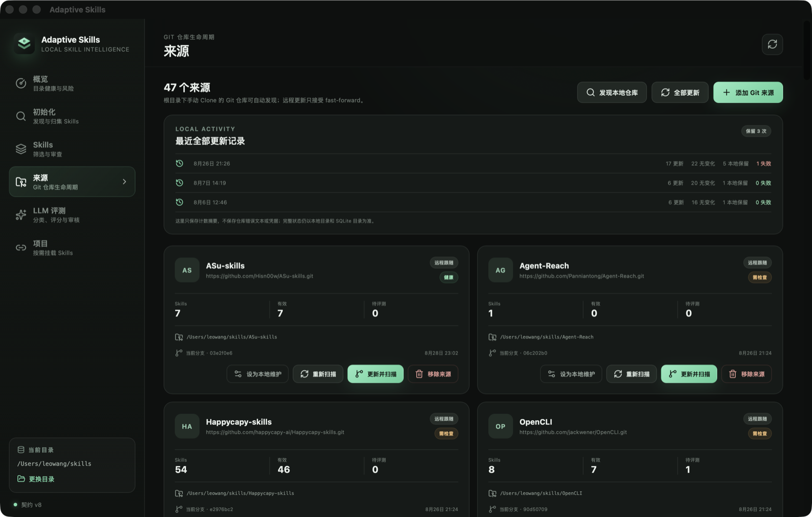
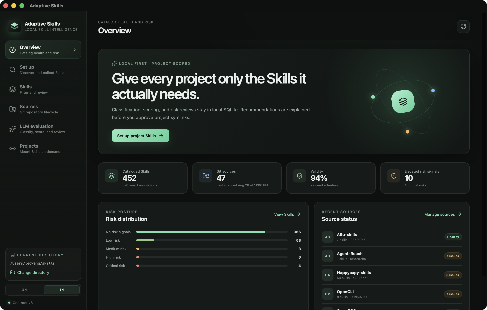
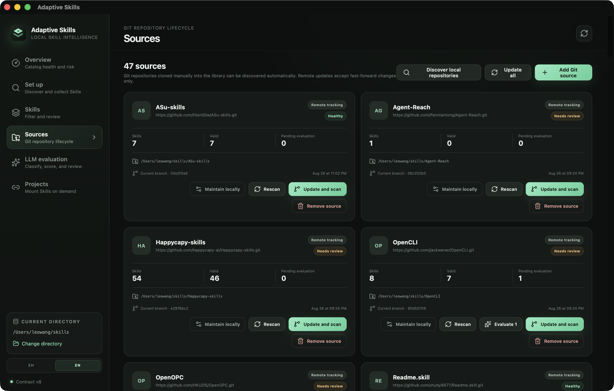

<p align="center">
  
</p>

<h1 align="center">Adaptive Skills</h1>

<p align="center"><a href="#中文">中文</a> · <a href="#english">English</a></p>

## 中文

### 管理理念

Skill 不应该全部塞进全局上下文。Adaptive Skills 以 `~/skills` 为本地受管仓库，统一收集、扫描和评测，再按项目或 Agent 的实际需求挂载能力。来源可追踪，已有文件默认不覆盖。

### 核心能力

- 发现、克隆、批量更新并安全移除多个 Git 来源。
- 解析 `SKILL.md` 与 YAML frontmatter，区分格式兼容性、能力提示和已确认风险。
- 使用 SQLite 建立可检索目录，并通过 Codex CLI、Claude Code 或 OpenAI 兼容 API 进行智能分类与评分。
- 按需求或固定分类推荐 Skill，解释匹配原因、质量和风险。
- 为项目和 Agent 创建受管条目：优先软链接，不支持时回退为受管副本；实体副本可备份后迁移。
- 保存来源更新、LLM 评测和项目变更历史；更新失败可展开脱敏详情、查看处理建议并单独重试。界面支持简体中文与英文。

### 界面

**目录概览** — 查看 Skill 数量、来源状态、有效率和风险分布。



**Git 来源** — 集中管理仓库生命周期、更新策略和批量拉取结果。



### 下载与安装

[下载 v0.1.18](https://github.com/wangsoft/Adaptive-Skills/releases/tag/v0.1.18)：macOS Apple Silicon（arm64）选择 DMG，Windows x64 选择安装 EXE，Linux x64 选择 AppImage 或 DEB。Release 附有 `SHA256SUMS`，可校验下载文件。

macOS 将应用拖入“应用程序”后打开。构建使用临时签名，**未经过 Apple 公证**；确认下载来源和校验值后，若系统拦截，可执行：

```bash
xattr -dr com.apple.quarantine "/Applications/Adaptive Skills.app"
open "/Applications/Adaptive Skills.app"
```

v0.1.18 起支持签名校验的应用内升级：每天至多检查一次，确认后才安装并重启。Linux DEB/RPM 通过系统包管理器更新。**v0.1.16 及更早版本首次升级需手动下载。** Windows 安装包目前未进行代码签名。

### 本地开发

需要 Python 3.12+、Node.js、Rust 和 Git。

```bash
uv sync --extra desktop
cd app
npm ci
npm run tauri -- dev
```

技术栈：Python · SQLite · PyYAML · React · TypeScript · Tauri。 [产品说明](docs/PRODUCT.md) · [设计说明](docs/DESIGN.md) · [MIT 许可证](LICENSE)

## English

### Management philosophy

Skills should not all live in the global context. Adaptive Skills treats `~/skills` as a locally managed library: collect, scan, and evaluate once, then mount only what each project or agent needs. Provenance stays visible, and existing files are preserved by default.

### Core capabilities

- Discover, clone, batch-update, and safely remove multiple Git sources.
- Parse `SKILL.md` and YAML frontmatter while separating format compatibility, capability hints, and confirmed risks.
- Build a searchable SQLite catalog and evaluate Skills through Codex CLI, Claude Code, or an OpenAI-compatible API.
- Recommend Skills by requirement or fixed taxonomy, with explanations for relevance, quality, and risk.
- Create managed project and agent entries: prefer symlinks, fall back to managed copies where required, and back up physical copies before migration.
- Keep source-update, LLM-evaluation, and project histories; inspect redacted update failures, get suggested actions, and retry individual sources. Switch between Simplified Chinese and English.

### Interface

**Catalog overview** — Review Skill counts, source health, validity, and risk distribution.



**Git sources** — Manage repository lifecycles, update policies, and batch pull results.



### Download and install

[Download v0.1.18](https://github.com/wangsoft/Adaptive-Skills/releases/tag/v0.1.18): choose the DMG for macOS Apple Silicon (arm64), the installer EXE for Windows x64, or AppImage/DEB for Linux x64. The release includes `SHA256SUMS` for download verification.

On macOS, drag the app into Applications and open it. The build is ad-hoc signed and **not notarized by Apple**. If macOS blocks it, verify the download source and checksum before running:

```bash
xattr -dr com.apple.quarantine "/Applications/Adaptive Skills.app"
open "/Applications/Adaptive Skills.app"
```

Starting with v0.1.18, in-app updates verify signatures, check at most daily, and require confirmation before installation and restart. Linux DEB/RPM installs use the system package manager. **Upgrading from v0.1.16 or earlier requires a manual download.** Windows installers are not currently code-signed.

### Run locally

Requires Python 3.12+, Node.js, Rust, and Git.

```bash
uv sync --extra desktop
cd app
npm ci
npm run tauri -- dev
```

Stack: Python · SQLite · PyYAML · React · TypeScript · Tauri. [Product](docs/PRODUCT.md) · [Design](docs/DESIGN.md) · [MIT License](LICENSE)
